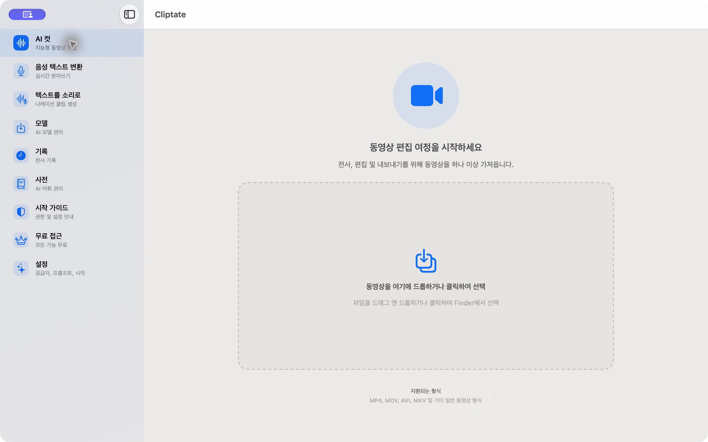

<div align="center">
  
  <h1>Cliptate</h1>
  <p><strong>Mac 오디오·비디오 크리에이터를 위한 온디바이스 AI 워크스페이스</strong></p>

  <p>
    <a href="https://apps.apple.com/cn/app/%E5%89%AA%E8%A8%80-cliptate/id6754441004?mt=12"></a>
    
    
    
    
  </p>

  <p>
    <a href="https://cliptate.github.io">웹사이트</a> ·
    <a href="https://cliptate.github.io#features">기능</a> ·
    <a href="https://cliptate.github.io#voice">음성 및 TTS</a> ·
    <a href="https://apps.apple.com/cn/app/%E5%89%AA%E8%A8%80-cliptate/id6754441004?mt=12">다운로드</a>
  </p>

  <p>
    <a href="README.md">English</a> ·
    <a href="README.zh.md">中文</a> ·
    <a href="README.ja.md">日本語</a> ·
    <a href="README.ko.md">한국어</a> ·
    <a href="README.de.md">Deutsch</a>
  </p>
</div>

---

Cliptate는 전사, 받아쓰기, 편집, 음성 합성을 통합한 네이티브 macOS 앱입니다. 음성 모델은 Mac에서 실행되며 온라인 AI 교정 및 번역 서비스는 선택적으로 설정할 수 있습니다.



---

## 소스에서 빌드

전체 앱은 [MIT 라이선스](LICENSE)로 공개됩니다.
Apple Silicon, macOS 15+, Xcode 26+ 및 Swift 6.2+가 필요합니다.

```bash
git clone https://github.com/cliptate/cliptate.git
cd cliptate
export DEVELOPER_DIR=/Applications/Xcode.app/Contents/Developer
swift test
./scripts/run.sh
```

[개발 가이드](docs/development.md), [아키텍처](docs/architecture/README.md),
[기여 가이드](CONTRIBUTING.md), [타사 라이선스](THIRD_PARTY_NOTICES.md)를 참조하세요.
모델은 별도로 다운로드하며 구독 서비스는 로컬 설정으로 선택적으로 구성합니다.


## 기능

### 🎙 음성 받아쓰기 — 말하는 대로 입력

실시간 스트리밍 음성-텍스트 변환을 입력기처럼 사용할 수 있습니다. 글로벌 키보드 단축키로 어느 앱에서든 호출하면 말하는 즉시 편집 가능한 텍스트가 생성됩니다.

- 최소 지연의 스트리밍 실시간 전사
- 다중 화자 자동 식별 및 레이블링
- 전문 용어 정확도 향상을 위한 사용자 정의 어휘 사전
- 어디서든 호출하거나 일시 중지할 수 있는 글로벌 단축키

### 📝 오프라인 전사

오디오·비디오 파일을 완전히 온디바이스에서 일괄 전사합니다. 여러 ASR 엔진(Parakeet, Qwen3, FireRed ASR)과 Apple Silicon 최적화 MLX 추론으로 서버에 오디오를 전송하지 않고도 정확한 자막을 생성합니다.

### ✂️ 스마트 침묵 제거

VAD 기반 무음 감지로 팟캐스트, 인터뷰, 강의 녹음의 불필요한 침묵을 자동으로 식별하고 일괄 제거합니다. 러프 컷이 납품 가능한 상태에 훨씬 빠르게 도달합니다.

### 👥 화자 분리

녹음에서 여러 화자를 자동으로 식별하고 레이블을 붙입니다. Sortformer와 Silero VAD 모델이 온디바이스에서 실행되어 인터뷰, 패널, 회의록에 화자 정보가 포함된 구조화된 전사문을 생성합니다.

### 🔊 TTS 음성 합성 — 네 가지 모드

| 모드 | 설명 |
|---|---|
| **프리셋 음성** | 내장 다국어 음성 라이브러리, 즉시 사용 가능 |
| **음성 클론** | 참조 오디오를 업로드하여 화자의 음색과 리듬 재현 |
| **감정 제어** | 텍스트 프롬프트로 지정된 화자의 감정과 스타일 조정 |
| **음성 디자인** | 텍스트로 음성 특성을 기술하여 완전히 독창적인 페르소나 합성 |

모든 TTS 추론은 MLX를 통해 온디바이스에서 실행됩니다. 오디오 데이터는 클라우드로 전송되지 않습니다.

### 🌐 AI 교정 및 번역

문맥 기반 전사문 교정 후 온디바이스 또는 Apple 번역을 통한 다국어 출력. 도구 전환 없이 글로벌 시청자를 위한 콘텐츠를 제작할 수 있습니다.

### ⭐ 하이라이트 감지

녹음에서 가장 중요한 문장과 주목할 만한 순간을 자동으로 찾아 타임라인에 표시합니다. 편집 및 게시 작업이 더 빠르게 진행됩니다.

---

## 내보내기 형식

Cliptate는 이미 사용 중인 툴로 직접 내보냅니다:

| 형식 | 용도 |
|---|---|
| **FCPXML** | Final Cut Pro 타임라인 프로젝트 교환 |
| **SRT** | 범용 자막 배포 |
| **ASS** | 위치 및 스타일 정보가 포함된 자막 |
| **VTT** | 브라우저 및 스트리밍 플랫폼용 웹 자막 |

**Final Cut Pro**, **DaVinci Resolve**, **Adobe Premiere Pro** 호환.

---

## 개인정보 보호 및 보안

- **로컬 음성 추론** — ASR, VAD, 화자 구분 및 TTS는 Mac에서 실행됩니다.
- **선택적 온라인 서비스** — AI 교정 및 번역은 설정한 엔드포인트와 API 키를 사용합니다.
- **오프라인 추론** — 모델 다운로드 후 사용할 수 있습니다. 다운로드, 구독 및 온라인 서비스에는 네트워크가 필요합니다.
- 민감한 콘텐츠에는 로컬 서비스를 선택하세요.

---

## 시스템 요구 사항

| | |
|---|---|
| **플랫폼** | macOS 15 Sequoia 이상 |
| **아키텍처** | Apple Silicon(M1 이상) |
| **저장 공간** | 모델 선택에 따라 다름 (전체 모델 세트: 2–8 GB) |

---

## 기술 스택

SwiftUI / AppKit, AVFoundation, MLX Audio, Hugging Face, RevenueCat / StoreKit을 사용합니다.

---

## 활용 사례

**팟캐스터 및 인터뷰어** — 침묵 제거, 자막 생성, 게시 가능한 구간 표시를 앱 내에서 완결.

**Vlog 및 숏폼 크리에이터** — 말하는 장면 편집을 더 부드럽게 만들고, 페이싱과 표현에 집중.

**강의 제작자 및 회의 기록자** — 음성 받아쓰기나 일괄 전사로 수 시간의 녹음을 검색·번역·납품 가능한 텍스트 자산으로 변환.

**다국어 콘텐츠 팀** — 음성 클론, 전사문 번역, 더빙 버전 생성을 Mac 한 대로 완성.

---

## 링크

- **웹사이트:** [cliptate.github.io](https://cliptate.github.io)
- **App Store:** [Cliptate 다운로드](https://apps.apple.com/cn/app/%E5%89%AA%E8%A8%80-cliptate/id6754441004?mt=12)
- **문의 및 피드백:** [GitHub Issues](https://github.com/cliptate/cliptate/issues)

---

<div align="center">
  <sub>개인정보 보호, 속도, 전문적인 출력을 중시하는 크리에이터를 위해 만들었습니다.</sub>
</div>
