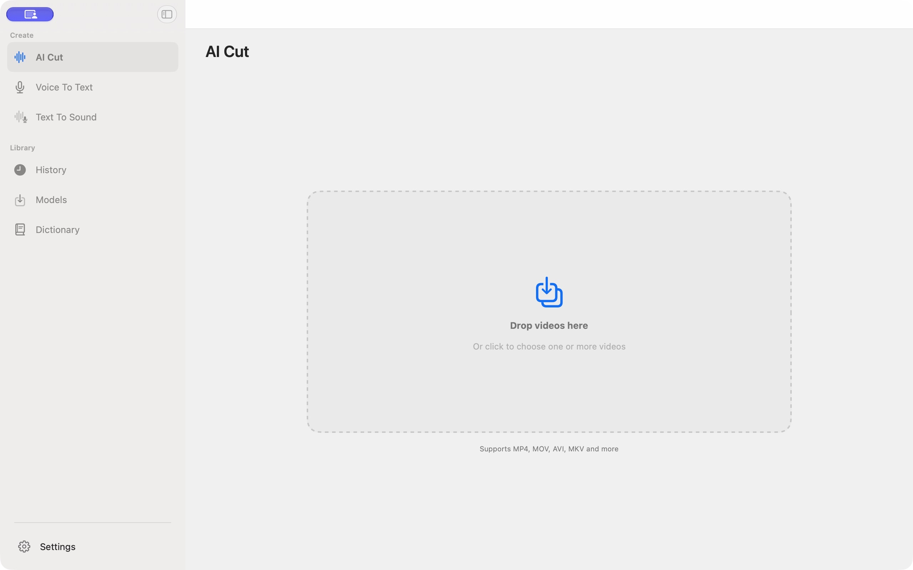

<div align="center">
  
  <h1>Cliptate</h1>
  <p><strong>On-device AI workspace for Mac audio and video creators</strong></p>
  <p>面向 Mac 音视频创作者的端侧 AI 工作台</p>

  <p>
    <a href="https://github.com/cliptate/cliptate/releases"></a>
    
    
    
    
  </p>

  <p>
    <a href="https://cliptate.github.io">Website</a> ·
    <a href="https://github.com/cliptate/skills">Skills</a> ·
    <a href="https://cliptate.github.io#features">Features</a> ·
    <a href="https://cliptate.github.io#voice">Voice & TTS</a> ·
    <a href="https://youtu.be/2MEVQTw3OVs">Video Demo</a> ·
    <a href="https://github.com/cliptate/cliptate/releases">Download</a>
  </p>

  <p>
    <a href="README.md">English</a> ·
    <a href="docs/README.zh.md">中文</a> ·
    <a href="docs/README.ja.md">日本語</a> ·
    <a href="docs/README.ko.md">한국어</a> ·
    <a href="docs/README.de.md">Deutsch</a>
  </p>
</div>

---

Cliptate is a native macOS app for turning speech into editable text, subtitles, and rough cuts. Transcribe recordings, dictate into other apps, trim pauses, and generate speech with models running on your Apple Silicon Mac.

**Cliptate is free:** all models and features are available, with no subscription or purchase required. Optional online AI services use your own provider configuration.

**[Watch the Cliptate video demo on YouTube](https://youtu.be/2MEVQTw3OVs).**



*Home shows dictation totals, activity over the last 12 months, and records by source.*

Use the sidebar to open **File Transcription**, **Voice Dictation**, or **Voice Generation**. **Settings** is always available at the bottom.

The interface supports English, Simplified Chinese, Japanese, Korean, and German; choose your display language in **Settings → Language**.

[Get started](#get-started) · [Features](#features) · [CLI](#command-line) · [Privacy](#privacy-and-models) · [Build from source](#build-from-source)

## Get started

### Download and install

1. Download `Cliptate.dmg` from [GitHub Releases](https://github.com/cliptate/cliptate/releases/latest). For daily builds, use the [Nightly prerelease](https://github.com/cliptate/cliptate/releases/tag/nightly).
2. Open the DMG, drag **Cliptate.app** into **Applications**, and launch it.
3. Open **Models** and download the models you need before your first transcription or speech synthesis session.

Release packages use Developer ID signing and Apple notarization. Each download includes a SHA-256 checksum file; see the [installation and verification guide](docs/development.md#dmg-packages-and-ci-downloads). Direct-download builds support [in-app updates](docs/updates.md).

### Requirements

| Requirement | Details |
| --- | --- |
| Mac | Apple Silicon (M1 or later) |
| System | macOS 15 Sequoia or later |
| Storage and memory | Depend on the selected models; check their sizes in Models |
| Network | Needed for initial model downloads and optional online services |

### Your first workflow

- **Recorded audio or video:** open **AI Cut**, import files, select a transcription model and language, then review the transcript and pause cuts before exporting.
- **Live dictation:** open **Voice To Text**, choose a model, configure a shortcut, and grant microphone access. Direct builds use Accessibility permission to deliver text into other apps; clipboard paste is the fallback.
- **Speech synthesis:** select a TTS model, enter text, and choose a preset voice, reference audio, or voice description supported by that model.

## Features

| Workflow | What you can do |
| --- | --- |
| **Offline transcription** | Batch-transcribe audio and video with Parakeet, Qwen3 ASR, FireRed, or Cohere models; choose an engine suited to your language and hardware. |
| **Voice dictation** | Stream speech to text, use a custom vocabulary dictionary, and invoke dictation with a configurable shortcut. |
| **AI Cut** | Detect pauses with voice activity detection (VAD), review segments, and export a rough cut. |
| **Speaker labels** | Use Sortformer diarization to distinguish speakers in supported transcription pipelines. Silero VAD detects speech without identifying speakers. |
| **Speech synthesis** | Use Qwen3 TTS for preset voices, voice cloning, emotion/style prompts, and voice design. Available controls depend on the selected model. |
| **Correction and translation** | Use an optional online AI provider for transcript correction and keyword emphasis; translate subtitles with Apple Translation for supported language pairs. |
| **Command line** | Transcribe files, generate WAV speech, and manage custom vocabulary from scripts or AI agents. |

## Export

| Output | Formats and use |
| --- | --- |
| Editing timeline | **FCPXML** for Final Cut Pro |
| Subtitles and transcripts | **SRT**, styled **ASS**, and timestamped **TXT** from the app |
| Video | **MP4**, **MOV**, **M4V**, with optional burned-in subtitles |
| Audio | **M4A**, **WAV** |
| CLI transcription | **Text**, **JSON**, **Markdown**, **SRT**, **VTT** |

Use subtitles and rendered media in editors such as DaVinci Resolve or Adobe Premiere Pro, subject to each editor's format support. FCPXML is the Final Cut Pro timeline workflow.

## Command line

The CLI is included in direct-download builds. Move the app to Applications first, then open **Settings → Command Line** and run the copied installation command in Terminal. Add `~/.local/bin` to your shell's `PATH` as described in the [CLI guide](docs/cli.md).

```bash
cliptate transcribe interview.mp4 --format srt --output interview.srt
cliptate transcribe recording.wav --format json --download
cliptate tts --text "Hello from Cliptate." --output speech.wav --download
cliptate dictionary add "Cliptate" "MLX"
```

The CLI uses the app's selected models and configuration, launching the app in the background when needed. `--download` allows missing models to be downloaded. CLI transcription accepts local files and does not create projects or history entries. Run `cliptate --help` or read the [full command reference](docs/cli.md) for batch output, model overrides, and scripting behavior.

## Privacy and models

Usage statistics are enabled by default and can be turned off in Settings. Google Analytics receives app activity and performance metadata, never audio, video, transcripts, or file names.

- **Local speech processing:** transcription, VAD, speaker diarization, and TTS inference run on your Mac. Downloaded speech models can be used offline.
- **Optional online AI:** correction and keyword extraction send text to the provider you configure. Keep these features disabled for an offline speech workflow.
- **Translation:** Apple Translation uses language resources that may need downloading; availability depends on the language pair.
- **Model storage:** weights are downloaded separately. Direct builds can reuse the Hugging Face cache at `~/.cache/huggingface/hub`; see [cache details](docs/development.md#shared-model-cache).
- **Licensing:** the application is [MIT licensed](LICENSE). Model weights and dependencies retain their own licenses; see [third-party notices](THIRD_PARTY_NOTICES.md).

## Build from source

Requires Apple Silicon, macOS 15+, and **Xcode 26+ with Swift 6.2+**.

```bash
git clone https://github.com/cliptate/cliptate.git
cd cliptate
export DEVELOPER_DIR=/Applications/Xcode.app/Contents/Developer
swift build
swift test
./scripts/run.sh
```

SwiftPM builds the app executable and CLI and runs unit tests. `./scripts/run.sh` assembles, signs, and launches the application as **Cliptate Dev.app** with separate development settings and data. To build the app without launching it, use `./scripts/build-and-run.sh build`.

Debug and Release both use free direct distribution, including the CLI and Accessibility-backed dictation. See the [development guide](docs/development.md) for signing, model caches, and distribution setup.

## Contribute and get help

Bug reports and feature requests belong in [GitHub Issues](https://github.com/cliptate/cliptate/issues). Include your macOS version, app version, selected model, and reproduction steps; avoid posting private recordings or credentials.

- [Contributing](CONTRIBUTING.md) — workflow, validation, and commit conventions
- [Architecture](docs/architecture/README.md) — code structure and runtime boundaries
- [Release notes](docs/release-notes/README.md#version-archive) — version history
- [Security policy](SECURITY.md) — reporting vulnerabilities
- [Website](https://cliptate.github.io) — product overview
