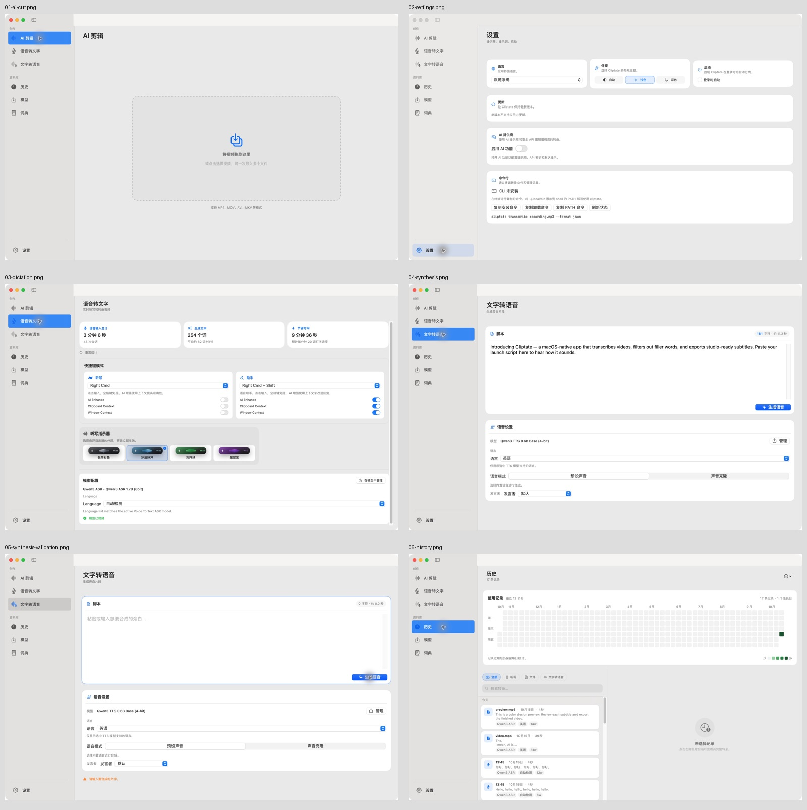
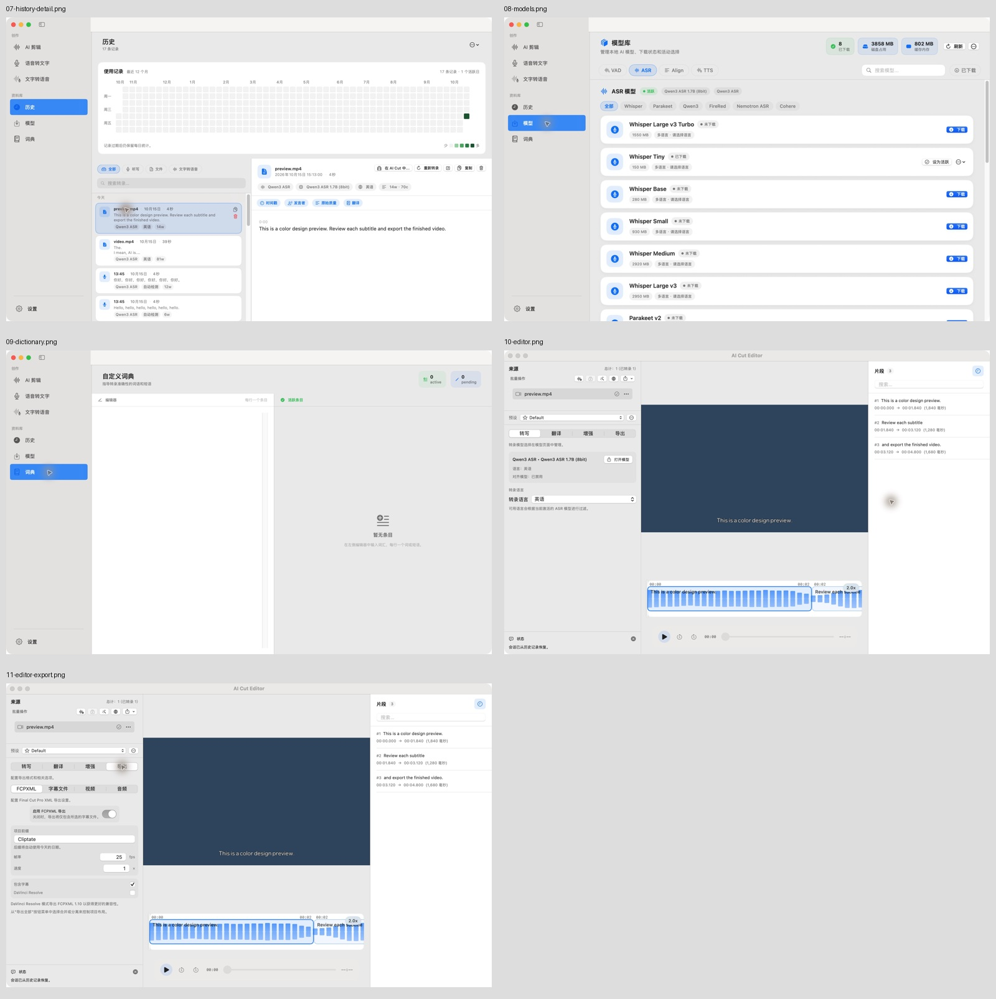

# Cliptate 界面审查 · 2026-10-15

本轮为审查报告，没有修改应用源码。用户选择 Anti Slop `after` 模式，后续按用户选定的编号修改。

## 范围与依据

- 基线：当前 checkout，HEAD `009d9cd`，macOS 开发版，中文界面，浅色，1280 × 800 pt，截图 2560 × 1600 px。
- 已重新执行 `DEVELOPER_DIR=/Applications/Xcode.app/Contents/Developer ./scripts/build-and-run.sh build` 和 `--verify`，均成功。审查开始时发现运行产物早于源码；旧版截图已隔离到 `/tmp/cliptate-ui-audit-stale-2026-10-15`，不用于以下结论。
- 技能：Apple Design、SwiftUI Expert、Anti Slop core / UI / Human、Product Design Audit。以系统控件、清晰层级、键盘操作、语义化颜色、可调整窗口为检查方向。
- 方向解读：面向视频创作者的 macOS 原生工具，ENERGY 1 / RHYTHM 1 / MOTION 1。这里是审查基准，不是新生成的视觉方案。
- 保留已有明确偏好：首页原始拖放区、侧栏选中图标蓝色。本报告不重新要求改变这两项。
- 证据分为「运行确认」「源码确认，待实测」「风险，待验证」。没有把截图判断当作完整无障碍认证。

## 页面与操作记录

| 步骤 | 页面或状态 | 实际检查 | 状况 |
| --- | --- | --- | --- |
| 01 | AI 剪辑首页 | 侧栏导航、拖放区可访问性名称、原有布局 | 本视口未见新的布局阻塞；未导入新文件 |
| 02 | 设置 | 语言、外观、启动、更新、AI、CLI 的初始显示和 AX 树 | 卡片能显示；选中语义见 2；小窗口待验证 |
| 03 | 语音转文字 | 统计、快捷键、指示器预览、模型与语言 | 本地化和主次层级需改进，见 3、6 |
| 04 | 文字转语音 | 脚本、模型、语言、语音模式、发言者 | 标签重复，见 5；未执行合成 |
| 05 | 文字转语音空输入 | 清空本地脚本草稿，点击生成 | 显示「请输入要合成的文字。」；反馈距离见 9 |
| 06 | 历史列表 | 17 条现有记录、热力图、筛选、空详情 | 层级与键盘语义见 1、2、6 |
| 07 | 历史详情 | 点击既有 `preview.mp4` 记录 | 详情可见；主操作标题截断，见 8 |
| 08 | 模型库 | ASR 列表、类别、提供商、下载状态、统计 | 卡片与视觉强调较重，见 7；未下载或切换模型 |
| 09 | 词典 | 空编辑器、空词条、统计标签与 AX 树 | 标签本地化及状态含义见 3、4 |
| 10 | 剪辑编辑器 | 从历史打开已有测试视频，查看转写配置、片段与布局 | 三栏可显示；播放时长尚未就绪，不作为播放功能验收 |
| 11 | 编辑器 FCPXML | 切换导出页，查看 FCPXML 控件及 AX 树 | 可显示；未提交导出；部分重复标签同见 5 |
| 12 | 编辑器视频导出 | 点击视频模块后尝试读取界面 | 检查工具原生管道中断，无有效截图；应用进程仍在运行 |

01 至 11 的截图均来自本轮当前源码构建。已重新打开保存文件形成的两张总览检查截图集合；大图是原始证据，总览仅用于索引。

## 编号问题清单

### 1. HIGH · 历史页窄布局没有详情呈现路径

- **证据：源码确认，待小窗口实测。** `HistoryView.swift:96` 在内容宽度小于 700 pt 时进入 `compactLayout`；`HistoryView.swift:166` 只返回 `listPanel`。记录点击在第 310 行仅设置 `selectedSessionID`，详情仅在宽布局的第 160 行呈现，没有窄布局的 push、sheet 或替代详情。
- **影响：** 窗口或内容区变窄后，用户选择记录无法看到完整转录和详情操作。源码中的分支是确定的；本轮窗口缩放工具没有可靠完成，未声称已在该尺寸复现。
- **规则：** R-26（操作必须产生有效结果）、R-03 / C-4（按桌面窗口适配理解）。
- **建议：** 窄布局提供原生列表到详情的导航及返回操作，保留当前记录、筛选和搜索。
- **验收：** 内容区 699 pt / 700 pt 两侧选择同一条记录，都能查看完整内容、复制和返回列表。

### 2. HIGH · 历史记录的选择缺少键盘与辅助功能入口

- **证据：源码与运行 AX 树共同确认。** 步骤 06、07 中，记录在 AX 树里是图片与 `text`，不是可选择行或按钮。`HistoryView.swift:515–536` 使用 `HStack.onTapGesture`，没有 `List(selection:)`、可聚焦选择操作或辅助功能 action。`sessionList` 是 `ScrollView + LazyVStack`。
- **影响：** 鼠标可以打开详情，键盘和辅助技术缺少等价的明确选择入口。
- **规则：** R-32。SwiftUI Expert 的控件语义要求也适用。
- **建议：** 使用原生可选择列表，或为记录主区域提供明确的按钮、焦点与选择语义；避免把复制、删除按钮嵌入另一个按钮。
- **相关缺口：** 设置外观、模型类别和历史筛选的自定义按钮只以颜色表示选中，当前 AX 树不报告选中值。可一并改用原生 Picker / Toggle，或补充 selected/value。词典 TextEditor 也没有明确可访问性名称。
- **限制：** 本轮尝试的完整键盘走查受工具焦点行为影响，未作为成功复现证据；上述结论依据源码和 AX 角色，不声称完成 VoiceOver 全流程。

### 3. LOW · 中文页面仍出现未本地化的英文功能文本

- **证据：运行确认。** 步骤 03 显示 `AI Enhance`、`Clipboard Context`、`Window Context`、`Language` 和英文语言帮助；步骤 09 显示 `active`、`pending`。步骤 04 初始脚本仍为固定英文示例。
- **定位：** `VoiceToTextView.swift:1024` 的辅助方法接收 `String`，再交给 `Text(title)`；`ModelAwareLanguageSelectionView.swift:5` / `:17` 同样把 String 当作已本地化内容。`DictionaryManagerView.swift:64`、`:70` / `:84` 也是该路径。`CliptateCore/Models/DataTypes.swift:820` 起还有硬编码语言数量说明，此项为源码发现，未用旧版模型截图证明。
- **规则：** R-20 / R-31（界面一致性），以及仓库明确的本地化约定。
- **建议：** 在调用处使用 `String(localized:)`，或让用于静态界面文本的组件接收 `LocalizedStringKey`；补齐 zh-Hans、ja、ko、de。英文示例可改为本地化示例或由用户显式加载。
- **验收：** 五种语言逐页检查；模型名、快捷键和原生语言名保留其正确写法。

### 4. MEDIUM · 词典的 pending 数量不代表待保存状态

- **证据：运行与源码确认。** 步骤 09 显示两枚 `active` / `pending` 统计。`DictionaryManagerView.swift:67` 把所有 `normalizedEditorEntries.count` 标为 pending，但 TextEditor 每次变化都会调用 `saveChanges()` 并立即更新配置。
- **影响：** 正常输入后，相同词条会同时计入 active 与 pending，界面暗示仍有待提交内容，却没有对应的提交动作。
- **规则：** R-09 / R-31，状态徽章应表达真实且有用的状态。
- **建议：** 沿用即时保存，合并成「N 个词条」并明确自动保存；只有真的引入草稿时才显示待保存数量。
- **验收：** 新增、去重、删除后，显示数量与实际生效词条一致；不留下含义不明的 pending。

### 5. LOW · 语言与发言者标签重复，表单对齐不统一

- **证据：运行确认。** 步骤 04、05 的语言先有上方标题，又有 Picker 标签；发言者同一行出现两个标签。步骤 10 的转录语言也重复出现。
- **定位：** `ModelAwareLanguageSelectionView.swift:15–31` 同时绘制 `Text(title)` 和带标签的 Picker；`TTSSynthesisView.swift:425–429` 同样重复绘制发言者标签。
- **规则：** R-05 / R-31。
- **建议：** 每个设置保留一个永久标签，使用原生 Form / LabeledContent 对齐；需要隐藏重复可视标签时保留辅助功能名称。
- **验收：** TTS、听写和编辑器共用语言组件后，无重复标签，辅助技术仍能读出控件用途。

### 6. LOW · 听写统计与历史热力图占据过多任务入口空间

- **证据：运行确认。** 步骤 03 首先是三张统计卡，模型和语言在页面靠下；步骤 06、07 的年度热力图占约 240 pt 高，列表与详情在它下方。1280 × 800 pt 下，记录区从窗口中部之后才开始。
- **规则：** R-05 / R-31，布局应服务实际任务。
- **建议：** 听写优先显示快捷键、模型、语言与可用状态；使用统计移至后方。历史页默认紧凑摘要，热力图可展开，保留现有真实统计。
- **理由：** 这些页面的主要任务是输入和找回转录，统计是辅助信息。
- **验收：** 常用模型/语言或历史记录无需先越过大统计区域，短窗口仍有足够内容高度。

### 7. MEDIUM · 模型库的每行阴影、卡片和胶囊重复强调

- **证据：运行与源码确认。** 步骤 08 中，每个模型占一张圆角卡片，普通行也有阴影、蓝色图标底座及多枚元数据胶囊。`ModelsView.swift:2258–2280` 对普通行也施加阴影。所有行都是同一平面上的列表项，额外浮起没有表达不同的层级。
- **规则：** R-12 / R-14。
- **建议：** 使用紧凑原生列表或分组行，靠分隔线、文字和状态区分模型；保留活动模型强调，下载动作不必与每行图标同时争夺蓝色强调。
- **理由：** 行是用于比较和管理的同级条目，减少重复外框有利于横向比较名称、状态和大小。
- **验收：** 同一视口容纳更多完整行，活动、下载中、错误和不可用状态仍清楚可辨。

### 8. LOW · 历史详情的主操作在常规视口已截断

- **证据：运行确认。** 步骤 07 中，「在 AI Cut 中打开」显示为「在 AI Cut 中…」。文件名、时间和五个操作竞争同一行宽度。
- **定位：** `HistoryView.swift:768–808` 的详情标题与 `actionRow` 固定排列在同一 HStack。
- **规则：** R-03 / R-05，按桌面窗口与分栏适配理解。
- **建议：** 让主操作保持完整；宽度不足时把操作换到下一行，次要动作进入原生菜单。为 Finder 图标增加明确的辅助功能名称。
- **验收：** 正常和窄详情栏、较长文件名、德语界面下，主操作可读且可达。

### 9. LOW · 语音合成的输入错误离输入位置太远

- **证据：运行确认。** 步骤 05 点击空脚本的「生成语音」后，错误出现在整个语音设置卡片之后。**本视口提示可见，并未被截断。** 它与应修正的脚本区域相隔一个完整设置面板。
- **定位：** `TTSSynthesisView.swift:83–88` 将 `feedbackRow` 放在 `voiceControlsCard` 后。
- **规则：** R-05 / R-31；R-27 的错误状态已经存在，本项不把它误报成缺少错误状态。
- **建议：** 输入验证放在脚本区或生成按钮旁；空白脚本可禁用生成并说明原因，失败后把焦点或提示关联到脚本。运行中的进度也应靠近触发操作。
- **验收：** 正常/短窗口点击空脚本时，原因与修正位置同时可见。

## 建议修改顺序

1. 功能与辅助操作：编号 1、2。
2. 明确含义与语言：编号 3、4、5、9。
3. 页面层级和视觉一致性：编号 6、7、8。

以上只是建议，尚未执行任何编号的修复。

## 未完成的检查与限制

- 目前是主要页面的首轮审查，不能称为「所有页面、所有状态均已验收」。
- 深色、增强对比度、降低透明度、降低动态效果、所有本地化和小窗口均未完成本轮运行验证。设置顶部固定三列也是源码适配风险，需缩窄窗口后确认，不单独列为已复现故障。
- 视频导出模块导致检查工具出现 `Sky Computer Use native pipe closed before response`；reset/reconnect 未立即恢复。重启本轮测试用开发进程后恢复，已回到 AI 剪辑首页。没有观察到应用退出，也没有将其描述成应用崩溃。
- 编辑器播放时长尚未就绪；截图仅支持布局审查，不支持正常播放、导出、字幕渲染时序的验收。
- 权限页、App Store 订阅/支付、更新弹窗、AI 提供商启用后的配置、语音克隆、预设/提示词等弹窗、编辑器翻译/增强/字幕/音频导出等子页，未取得本轮有效运行截图。需要各自补查；没有为覆盖而修改权限、配置服务或发起付费操作。
- 没有新增词典条目、下载模型、录音、执行合成、发起远程 AI 请求、提交导出或更改外观偏好。空脚本只修改页面本地草稿，离页和重启后不持久化。
- 原生菜单缩放和键盘走查有工具目标/焦点不稳定，相关尝试不算有效产品失败证据。
- 截图受活动/非活动窗口、光标提示影响。不根据它们推断系统禁用状态或精确颜色对比度数值。

## 审查交付门禁

- **Hard Gate / PASS（审查产物）：** 已构建并启动当前源码；明确区别运行证据、源码推断、未验证状态；未虚构数据、操作结果或完整无障碍合规结论。产品的 R-26 / R-32 问题已列为待修，未宣布产品通过验收。
- **Purpose Gate / PASS（建议）：** 原生控件用于行为和可访问性；扁平列表用于比较同级模型；统计降级用于腾出主要任务空间。每项视觉建议都附有任务理由。
- **Liveliness / PASS（审查基准）：** 已声明 1 / 1 / 1；系统字体和语义色维持 macOS 工具的一致性，强调色服务选择与主要动作。没有生成视觉资产或新增设计方案。
- **Craftsmanship / PASS（报告）：** 编号、优先级、证据、修复建议和验收方式齐全；未将代码检查包装为全流程实测。
- **R-35 覆盖记录 / PASS（记录完整性）：** 各主导航均打开；点击历史记录显示详情；从历史恢复编辑器成功；切换 FCPXML 成功；空脚本提交出现验证消息。其他交互明确列在未验证范围，不声称逐项通过。

本轮仅交付审查结论；设计修改与产品完整验收等待后续选定范围。
