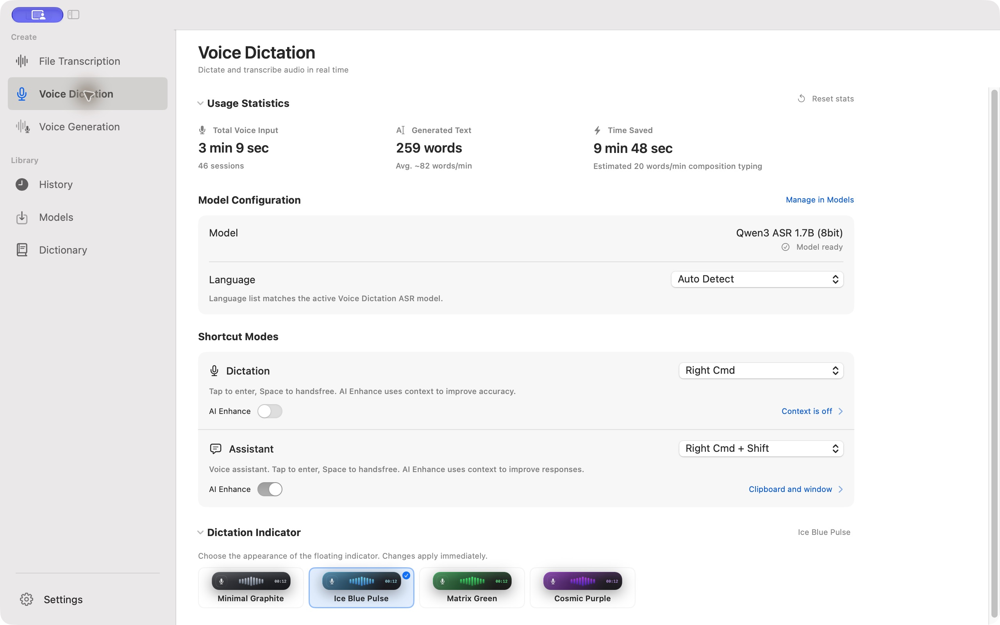
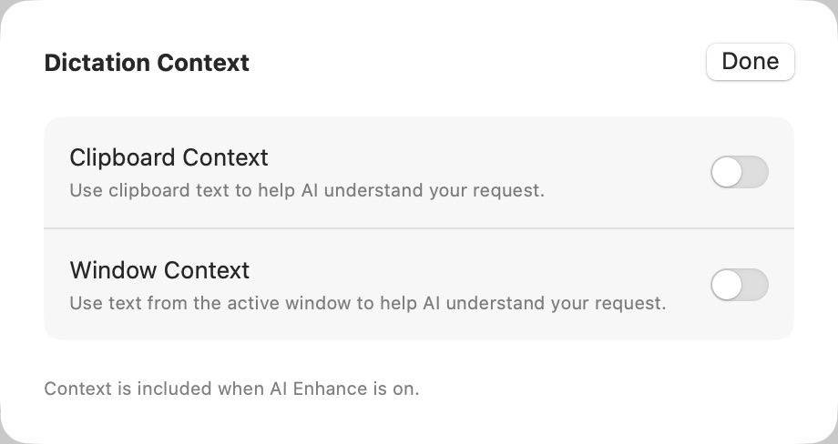
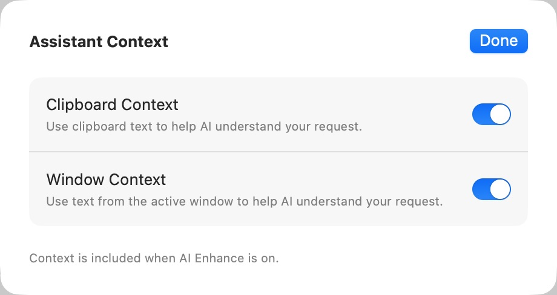

# 语音听写页 · 本机 Spokenly 审查后的实现

用户批准按本机审查建议继续优化。沿用 Apple Design、SwiftUI Expert、Anti Slop after 模式；本轮实现听写页的白色画布、轻灰设置分组、上下文详情和紧凑设置行。ENERGY 1 / RHYTHM 1 / MOTION 1。参考依据为 [本机分析](spokenly-native-analysis-2026-10-16.md)，保留 Cliptate 的功能和用户指定的信息顺序。

## 修改

- 使用系统文本背景色作为听写页内容和标题背景，以语义颜色适配系统主题；设置组使用轻灰填充。新增可复用的 surface 值，公共页标题可选择背景色，其他页面沿用原默认值。
- Usage 继续置顶、默认展开；重置入口移到标题行，保留确认和取消流程。
- 模型名与就绪状态合并为右侧摘要；语言菜单收窄并靠右。公共语言控件通过默认关闭的紧凑参数支持本页，模型过滤和语言自动回退逻辑不变。
- 听写与助手各自保留快捷键、说明和 AI Enhance；上下文选项移入独立 sheet，行内显示当前状态并提供链接入口。
- 两个 sheet 直接绑定各自原有的 AppConfiguration 字段，支持 Done、Return 与 Escape 关闭；没有新增持久化字段或改变权限交付逻辑。
- Dictation Indicator 保持默认展开，原有外观选择保留。
- 新增 7 个本地化键，均补齐 zh-Hans、ja、ko、de；JSON 唯一键检查通过。

## 验证

- Full Xcode 下最终 `./scripts/build-and-run.sh build` 构建与签名通过，日志 `/tmp/cliptate-native-style-final-build.log`。
- `swift test --filter 'VoiceUsageStatsTests|ContentNavigationTests|VoiceShortcutStateTests|ModelCacheManagerLanguageTests'`：4 个测试套件、58 项测试通过。日志 `/tmp/cliptate-native-style-tests.log`。之后只修正详情开关对齐和上下文链接样式，最终构建及对应界面复测通过。
- 重新启动最终构建，两个上下文入口均进入对应 sheet；听写两个开关仍为 off，助手两个开关仍为 on；Return 和 Escape 关闭通过。仅查看原有状态，没有改动上下文选项。
- Usage 和指示器收起、展开通过；重置统计对话框取消后原有统计保留；紧凑语言菜单打开并显示当前选择。
- 模型管理入口通过；八次跨页面切换均保留目标标题可见。最后链接样式修正后，再次复测两个入口及「词典 → 文件转录 → 语音听写」原始跳动路径通过。
- `git diff --check` 通过。
- [原生 UI 回归记录](native-style-2026-10-16/regression.json)。

## 最终截图

## 交付检查与范围

- Hard Gate：已验证范围通过；上下文入口有独立可访问名称和当前状态，详情开关有明确名称，键盘关闭和重置确认可用。新文案四种目标语言齐全，无占位统计数据。
- Purpose：Usage 便于直接查看，低频上下文选项进入详情，模型与语言行减少冗余高度。
- Liveliness：沿用原生系统字体、强调色和现有录音预览；没有新增装饰动画。
- Craftsmanship：实际截图发现的开关错位和上下文入口过淡已修正，最终应用与对应操作已复测。
- 本轮现场检查为英文、浅色、1280 × 801 pt。未全面验证其他语言、深色、窄窗口和 VoiceOver，不据此声明完整可访问性达标。颜色采样会受截图抗锯齿影响，未把单次像素采样当作整页对比度认证。
- 本轮聚焦语音听写页；模型库列表重构以及向语音生成、完整设置页推广同一规范，属于后续范围。
