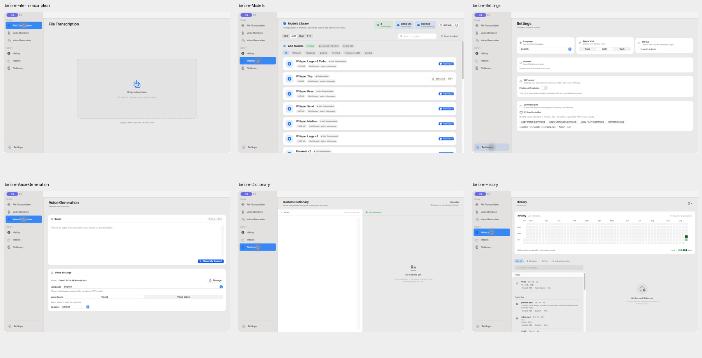
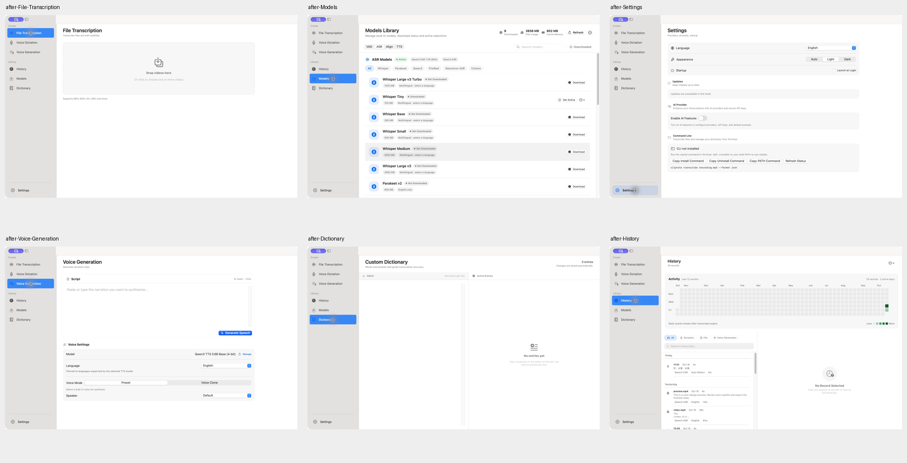

# 其他主要页面风格统一 · 2026-10-16

本轮沿用本机 Spokenly 审查所得的白色内容区、轻灰设置分组、紧凑设置行与连续列表方向。使用既有 Apple Design、SwiftUI Expert、Anti Slop 指导；用户直接授权继续优化其他页面。沿用 ENERGY 1 / RHYTHM 1 / MOTION 1。

开始时工作区已有语音听写页、共享底色、语言控件及相关本地化的未提交修改。本轮保留这些内容，基于已有 `contentBackground`、`settingsBackground` 和语言控件紧凑模式扩展其余页面。

## 修改结果

| 页面 | 修改 |
| --- | --- |
| 文件转录 | 白色内容区，补齐现有页面说明；拖放区移到标题下方，与其他设置页的阅读列对齐；收紧高度，移除悬停放大和外发光，保留边界和填充反馈 |
| 语音生成 | 白色内容区与固定最大阅读宽度；脚本编辑保留焦点边界和生成主按钮；声音设置改为轻灰分组，模型、语言和说话人右对齐；添加脚本编辑器的辅助功能名称 |
| 模型库 | 三类识别/对齐/VAD 模型与 TTS 模型均改为连续分隔行；移除逐行圆角阴影，使用共同边界和当前模型整行浅色选中；弱化顶部指标底色，并保留下载、激活与溢出操作 |
| 设置 | 语言、外观和启动改为一个纵向设置组；更新、AI 服务和命令行采用组标题与轻灰内容区；不再将三个基础设置并排挤在小卡片中 |
| 历史 | 页面和未选择记录区域统一内容底色；活动统计使用轻灰分组，保留现有筛选、原生记录选择和详情布局 |
| 词典 | 标题与页面统一内容底色和字号；编辑列工具栏采用轻灰底，已激活词条标题使用中性颜色；保留双栏和自动保存机制 |

本轮没有改动导航详情列的尺寸约束、原始导航标识、模型业务逻辑、推理运行时、APP_STORE 能力开关或用户数据。未新增用户可见文案，复用现有翻译键。

## 前后对照

单页截图：

- [文件转录](after-File-Transcription.png)
- [语音生成](after-Voice-Generation.png)
- [模型库](after-Models.png) / [TTS 模型](after-TTS-models.png)
- [设置](after-Settings.png)
- [历史](after-History.png)
- [词典](after-Dictionary.png)

截图通过 Computer Use 获取，并检查保存文件生成的总览；模型库 TTS 页面单独复核了保存截图。全部证据保存在本地，没有上传或纳入 Git。

## 验证

- Full Xcode 下 `./scripts/build-and-run.sh build` 构建和签名通过，日志 `/tmp/cliptate-other-pages-build.log`。
- 完整 `swift test` 通过，Swift Testing 应用 756 项、核心 34 项；既有 XCTest 也通过，日志 `/tmp/cliptate-other-pages-tests.log`。
- 重启新构建后，七个主要页面共 21 次导航切换通过，每次均检查目标标题；未出现原侧栏离开可见区域的失败。
- 模型的 VAD、Align、TTS、ASR 分类切换通过；搜索无结果状态、清空搜索、已下载筛选与还原通过。
- 语音生成输入临时文本，确认 18 字符计数后清空；预设/克隆模式切换通过，并恢复预设；模型管理链接进入模型库通过。
- 文件转录的拖放区点击打开文件选择器，取消返回通过；没有导入或转录文件。
- 设置语言菜单打开与退出通过，保持原有 English；没有更改语言、外观、启动或 AI 配置。
- `git diff --check` 通过。[原生回归记录](regression.json)。

本轮现场验证为英文、浅色、1280 × 801 pt 窗口。没有全面检查其他语言、深色、窄窗口、VoiceOver、模型下载、推理和实际音频生成；不将这些范围记为通过。没有新增仅复述布局实现的单元测试。

## 交付检查

- Hard Gate：已验证范围内的控件、入口、原生导航与构建通过；没有新增占位或伪造数据。
- Purpose：页面各自保留主任务，脚本编辑、文件导入和模型比较优先，颜色和边界用于区分层级。
- Liveliness：延续系统字体、原生强调色和静态分组；拖放仅保留轻量状态反馈，不使用悬停缩放与外发光。
- Craftsmanship：六页前后截图、TTS 列表、完整测试和实际交互均已留存，并记录主题、语言和窗口尺寸的验证边界。
