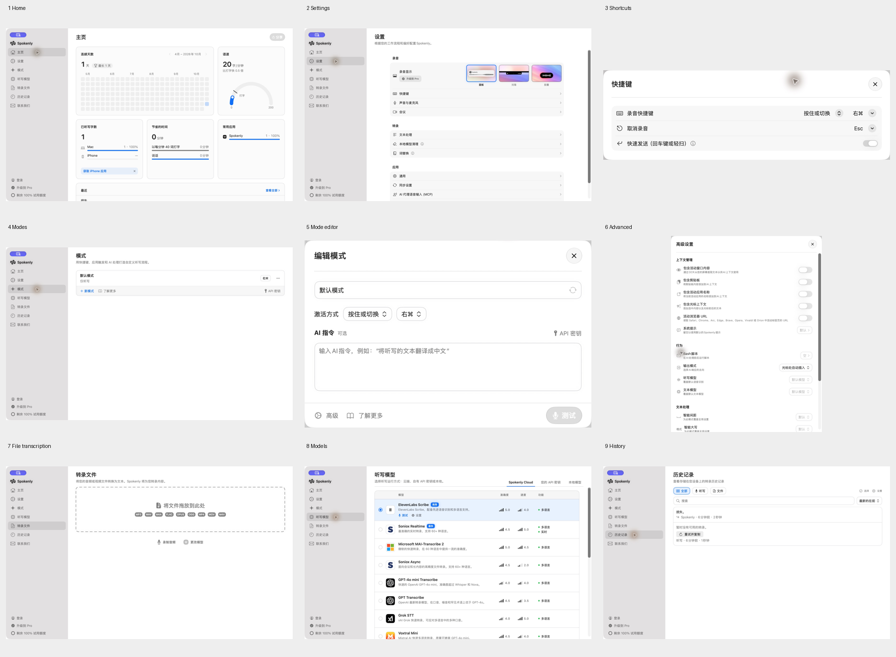

# Spokenly 本机界面分析 · 2026-10-16

使用 Product Design Audit、Apple Design 与既有 Anti Slop 方向，直接操作本机已安装的 Spokenly。设置页显示版本 **v2.31.2 (598) · Sideload**。本报告只依据本轮原生 UI 截图与辅助功能树；官网截图没有作为本轮审查证据。

目标：明确 Spokenly 的视觉与交互组织方式，为 Cliptate 下一轮优化提供具体依据。本轮未修改 Cliptate 源码，也未修改 Spokenly 的配置。

## 检查步骤与结果

| 步骤 | 页面与操作 | 观察结果 | 截图 |
| --- | --- | --- | --- |
| 1 | 主页 | 层级清楚；统计占首屏大部分，最近记录需要继续向下查看 | [主页](spokenly-native-2026-10-16/01-home.png) |
| 2 | 设置 | 录音、转录、应用三类分组明确；预览和可进入的设置行分工清楚 | [设置](spokenly-native-2026-10-16/02-settings.png) |
| 3 | 设置 → 快捷键 | 独立面板只显示录音快捷键、取消录音和快速发送，内容集中 | [快捷键](spokenly-native-2026-10-16/03-shortcuts.png) |
| 4 | 模式列表 | 名称、用途、快捷键可直接扫读；管理动作集中在列表底部 | [模式](spokenly-native-2026-10-16/04-modes.png) |
| 5 | 默认模式 → 编辑模式 | 常用设置集中在名称、激活方式、AI 指令；进一步设置放在“高级”入口 | [编辑模式](spokenly-native-2026-10-16/04b-mode-detail.png) |
| 6 | 编辑模式 → 高级 | 上下文管理、行为、文本处理和模型参数分组；内容长，需要滚动 | [高级设置](spokenly-native-2026-10-16/04c-mode-advanced.png) |
| 7 | 转录文件 | 拖放区为唯一主焦点，录制音频和更改模型作为次级入口 | [文件转录](spokenly-native-2026-10-16/05-file-transcription.png) |
| 8 | 听写模型 | 统一列比较模型、准确度、速度和功能，当前模型整行高亮；本地标签未成功切换，未审查本地列表 | [模型](spokenly-native-2026-10-16/06-models.png) |
| 9 | 历史记录 | 类型筛选、搜索、排序分开；无转录条目提供重试入口，实际重试未执行 | [历史](spokenly-native-2026-10-16/07-history.png) |

所有图片均通过 Computer Use 捕获，在本轮显示检查，并从保存文件生成总览再次检查。首页和设置等较长页面只覆盖当前可见区域；这些是视口截图，不是整页截图。截图可能包含已有的本机历史记录，只保存在本地审查目录。

## 核心设计语言

**1. 白色内容画布、浅灰侧栏，浅灰分组承载设置。** 设置页尤其明显：外围白色，分组只有轻微灰色填充，边界主要靠留白和细分隔线。模式列表和模型表格使用细边框。各页随内容选择边界方式，没有把所有区域都做成独立白卡片。

**2. 页标题、说明、内容有固定的左侧起点。** 标题下通常只有一行灰色说明，随后直接进入实际内容。设置页内部再缩进形成阅读列。页面留有大块空白，模式列表只有一项时也不会拉高内容填满窗口。

**3. 字重承担多数层级，颜色只表达状态和动作。** 标题、组名、主标签用深色；说明和元数据用灰色。蓝色主要用于有效入口、当前模型和选中预览。侧栏的灰色选中背景与主内容区的蓝色选中状态用途不同，不应简单统一为一种颜色。

**4. 行内摘要与详情面板分工。** 设置页的一行代表一个设置主题，右侧箭头进入详情。模式列表显示名称、用途和快捷键；编辑模式显示常用项，高级面板再承载上下文、输出和模型覆盖。视觉简洁来自信息分层，而不只是字号更小。

**5. 列表页使用共同列与共用边界。** 模型页的主信息在左，比较信息在右；只有当前模型显示测试和设置动作。历史条目在共同边框内以分隔线区分，避免每行独立阴影和厚重容器。

## 不宜直接照搬的部分

- 首页的连续天数热图、仪表盘和推广入口适合其使用习惯激励，但会占用 Cliptate 听写设置的首屏。保留用户指定的顶部 Usage 三项摘要即可。
- 模型准确度与速度评分的依据没有在当前截图中说明。Cliptate 可以借鉴表格对齐，但应优先呈现可核实的大小、语言支持、下载与激活状态，不能照抄评分。
- 模式 → 编辑 → 高级需要多层进入。Cliptate 可先保留两种模式的常用快捷键与 AI Enhance，复杂上下文按需进入详情，不必复制全部层级。
- 文件转录的格式标签较多且视觉较重；Cliptate 可以继续用简洁的支持格式说明。

## 对照当前 Cliptate 的改进建议

[本轮 Cliptate 听写页截图](spokenly-native-2026-10-16/08-cliptate-current.png)。两款应用的窗口尺寸与语言不同，本报告用于比较组织方式与视觉层级，不作为像素级还原验收。

| 优先级 | 当前差异 | 建议 |
| --- | --- | --- |
| 高 | Cliptate 的灰色主画布和白色设置块对比更强，整体更像多个卡片叠放 | 先在听写页试用白色内容画布与轻灰设置分组；通过系统语义颜色适配主题，再考虑推广到其他页 |
| 高 | 听写与助手把全部上下文开关直接摊在首页，两组重复说明占据高度 | 行首保留名称、快捷键和 AI Enhance，将上下文设置提供明确的详情入口与当前摘要；Usage 和 Dictation Indicator 继续默认展开 |
| 中 | Model、Language 和模型就绪状态各自占一段，长下拉框横跨整行 | 使用标签左对齐、值与控件右对齐的设置行；非异常就绪状态做为模型的次级摘要，异常状态仍需清楚呈现 |
| 中 | 重置统计独占 Usage 底部一行 | 改为标题行的次级操作或有文字说明的菜单入口，保留既有确认行为，减少统计区高度 |
| 中 | 模型库原有大卡片不利于同时比较更多模型 | 下一轮将模型库改为统一列表，名称、能力与本地状态对齐，操作靠右；不引入未经验证的速度或准确度分数 |
| 低 | 指示器预览带有较强的发光视觉 | 保留选中边框和实际外观预览，弱化设置页面的额外装饰，预览本身仍要忠实反映录音指示器 |

建议先完成前三项，建立听写页的白底、浅灰分组和设置行规范，再将同一规范用于语音生成、模型库与设置页。顶层原生导航结构沿用现有修复，避免为了视觉样式改动导航尺寸协商。

## 可访问性与证据边界

- 截图中可见文本说明、图标与选中背景相互配合，模式快捷键使用键帽样式，历史失败条目有可见重试入口。
- 部分灰色辅助文字较淡，尚未做像素采样与对比度计算，不能声称对比度达标。
- 本轮辅助功能树将模型分类标签合并为文本，将部分上下文开关呈现为无独立名称的开关；存在语义暴露风险，需 VoiceOver 与键盘实测确认。通过截图坐标尝试本地模型标签未切换，记录为本轮工具覆盖限制，不据此认定产品按钮损坏。
- 未执行模型下载、模型切换、音频录制、云端转录、重试、登录或付费操作。未全面测试深色、窄窗口、键盘焦点、VoiceOver 和动效，因此不对推理质量、运行性能或完整可访问性作结论。
- 截图左上角紫色屏幕共享标记及鼠标光圈属于本轮系统/Computer Use 环境，不作为 Spokenly 的产品设计元素。
