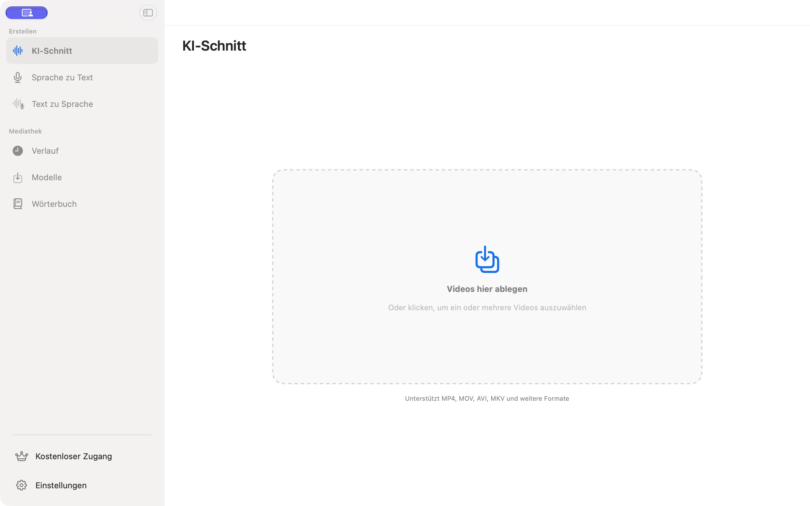

<div align="center">
  
  <h1>Cliptate</h1>
  <p><strong>Der KI-Arbeitsbereich auf dem Gerät für Mac-Audio- und Videoersteller</strong></p>

  <p>
    <a href="https://github.com/cliptate/cliptate/releases"></a>
    
    
    
    
  </p>

  <p>
    <a href="https://cliptate.github.io">Website</a> ·
    <a href="https://cliptate.github.io#features">Funktionen</a> ·
    <a href="https://cliptate.github.io#voice">Sprache & TTS</a> ·
    <a href="https://github.com/cliptate/cliptate/releases">Download</a>
  </p>

  <p>
    <a href="../README.md">English</a> ·
    <a href="README.zh.md">中文</a> ·
    <a href="README.ja.md">日本語</a> ·
    <a href="README.ko.md">한국어</a> ·
    <a href="README.de.md">Deutsch</a>
  </p>
</div>

---

Cliptate ist eine native macOS-App, die Sprache in bearbeitbaren Text, Untertitel und Rohschnitte umwandelt. Transkribieren Sie Aufnahmen, diktieren Sie in andere Apps, kürzen Sie Pausen und erzeugen Sie Sprache mit Modellen auf Ihrem Apple Silicon Mac.

**Die GitHub-Downloadversion ist kostenlos:** Alle Modelle und Pro-Funktionen sind ohne Abonnement oder Kauf verfügbar. Optionale Online-KI-Funktionen nutzen den von Ihnen konfigurierten Dienst.



Ziehen Sie Videos in den Importbereich oder klicken Sie darauf, um eine oder mehrere Dateien auszuwählen. Wechseln Sie über die Seitenleiste zwischen den Funktionen. **Kostenloser Zugang** und **Einstellungen** sind unten jederzeit erreichbar.

Die Oberfläche unterstützt Englisch, vereinfachtes Chinesisch, Japanisch, Koreanisch und Deutsch. Die Anzeigesprache lässt sich unter **Einstellungen → Sprache** ändern.

[Einstieg](#einstieg) · [Funktionen](#funktionen) · [Kommandozeile](#kommandozeile) · [Datenschutz](#datenschutz-und-modelle) · [Quellcode bauen](#aus-dem-quellcode-bauen)

## Einstieg

### Herunterladen und installieren

1. Laden Sie `Cliptate.dmg` von [GitHub Releases](https://github.com/cliptate/cliptate/releases/latest) herunter. Tägliche Builds finden Sie in der [Nightly-Vorabversion](https://github.com/cliptate/cliptate/releases/tag/nightly).
2. Öffnen Sie das DMG, ziehen Sie **Cliptate.app** in den Ordner **Programme** und starten Sie die App.
3. Öffnen Sie **Modelle (Models)** und laden Sie die benötigten Modelle vor der ersten Transkription oder Sprachsynthese herunter.

Release-Pakete sind mit Developer ID signiert und von Apple notarisiert. Eine SHA-256-Prüfsummendatei liegt bei; siehe [Installation und Prüfung](development.md#dmg-packages-and-ci-downloads). Direkte Downloads unterstützen [Updates in der App](updates.md).

### Voraussetzungen

| Voraussetzung | Details |
| --- | --- |
| Mac | Apple Silicon (M1 oder neuer) |
| System | macOS 15 Sequoia oder neuer |
| Speicherplatz und Arbeitsspeicher | Abhängig von den gewählten Modellen; Größen stehen in der Modellübersicht |
| Netzwerk | Für den ersten Modelldownload und optionale Online-Dienste erforderlich |

### Der erste Workflow

- **Aufnahmen und Videos:** Öffnen Sie **AI Cut**, importieren Sie Dateien und wählen Sie Transkriptionsmodell und Sprache. Prüfen Sie Text und Pausenschnitte vor dem Export.
- **Live-Diktat:** Wählen Sie unter **Voice To Text** ein Modell und ein Tastaturkürzel und erlauben Sie den Mikrofonzugriff. Direkte Downloads verwenden die Bedienungshilfen-Berechtigung zur Texteingabe in andere Apps; alternativ können Sie über die Zwischenablage einfügen.
- **Sprachsynthese:** Wählen Sie ein TTS-Modell, geben Sie Text ein und verwenden Sie eine vom Modell unterstützte Preset-Stimme, Referenzaufnahme oder Stimmbeschreibung.

## Funktionen

| Workflow | Möglichkeiten |
| --- | --- |
| **Offline-Transkription** | Audio und Video mit Parakeet, Qwen3 ASR, FireRed oder Cohere im Stapel transkribieren. Wählen Sie ein Modell passend zu Sprache und Hardware. |
| **Diktat** | Streaming-Transkription, eigenes Wörterbuch und ein konfigurierbares Tastaturkürzel. |
| **AI Cut** | Pausen mit Sprachaktivitätserkennung (VAD) erkennen, Segmente prüfen und einen Rohschnitt exportieren. |
| **Sprecherzuordnung** | Sortformer unterscheidet Sprecher in unterstützten Transkriptionsabläufen. Silero VAD erkennt Sprache, identifiziert aber keine Sprecher. |
| **Sprachsynthese** | Qwen3 TTS bietet Preset-Stimmen, Stimmklonen, Emotions- und Stilvorgaben sowie Stimmdesign. Verfügbare Einstellungen hängen vom Modell ab. |
| **Korrektur und Übersetzung** | Optionale Online-KI korrigiert Text und hebt Schlüsselwörter hervor. Apple Übersetzen übersetzt Untertitel für unterstützte Sprachpaare. |
| **Kommandozeile** | Dateien transkribieren, WAV-Sprache erzeugen und das Wörterbuch aus Skripten oder KI-Agenten verwalten. |

## Export

| Ausgabe | Formate und Einsatz |
| --- | --- |
| Schnitt-Timeline | **FCPXML** für Final Cut Pro |
| Untertitel und Transkripte | **SRT**, gestaltetes **ASS** und **TXT** mit Zeitstempeln aus der App |
| Video | **MP4**, **MOV**, **M4V**, optional mit eingebrannten Untertiteln |
| Audio | **M4A**, **WAV** |
| CLI-Transkription | **Text**, **JSON**, **Markdown**, **SRT**, **VTT** |

Untertitel und gerenderte Medien lassen sich je nach Formatunterstützung in DaVinci Resolve, Adobe Premiere Pro und anderen Editoren nutzen. FCPXML ist für den Timeline-Workflow in Final Cut Pro vorgesehen.

## Kommandozeile

Direkte Downloads enthalten die CLI. Verschieben Sie die App zuerst nach Programme. Öffnen Sie **Einstellungen → Kommandozeile (Settings → Command Line)** und führen Sie den kopierten Installationsbefehl im Terminal aus. Fügen Sie `~/.local/bin` gemäß der [CLI-Anleitung](cli.md) zum `PATH` Ihrer Shell hinzu.

```bash
cliptate transcribe interview.mp4 --format srt --output interview.srt
cliptate transcribe recording.wav --format json --download
cliptate tts --text "Willkommen bei Cliptate." --output speech.wav --download
cliptate dictionary add "Cliptate" "MLX"
```

Die CLI verwendet Modelle und Einstellungen der App und startet sie bei Bedarf im Hintergrund. `--download` erlaubt das Herunterladen fehlender Modelle. CLI-Transkription akzeptiert lokale Dateien und erzeugt weder Projekte noch Verlaufseinträge. Details zu Stapelausgabe, Modellwahl und Skripten stehen unter `cliptate --help` und in der [vollständigen Befehlsreferenz](cli.md).

## Datenschutz und Modelle

- **Lokale Sprachverarbeitung:** Transkription, VAD, Sprecherzuordnung und TTS-Inferenz laufen auf Ihrem Mac. Heruntergeladene Sprachmodelle können offline genutzt werden.
- **Optionale Online-KI:** Korrektur und Schlüsselwortextraktion senden Text an den konfigurierten Dienst. Deaktivieren Sie diese Funktionen für einen Offline-Sprachworkflow.
- **Übersetzung:** Apple Übersetzen benötigt möglicherweise einen Download von Sprachressourcen. Die Verfügbarkeit hängt vom Sprachpaar ab.
- **Modellspeicher:** Gewichte werden separat heruntergeladen. Direkte Downloads können den Cache unter `~/.cache/huggingface/hub` wiederverwenden; siehe [Cache-Details](development.md#shared-model-cache).
- **Lizenzen:** Die App steht unter der [MIT-Lizenz](../LICENSE). Modellgewichte und Abhängigkeiten behalten eigene Lizenzen; siehe [Drittanbieter-Hinweise](../THIRD_PARTY_NOTICES.md).

## Aus dem Quellcode bauen

Erforderlich sind Apple Silicon, macOS 15+ und **Xcode 26+ mit Swift 6.2+**. Das Xcode-Testziel benötigt macOS 15.5+.

```bash
git clone https://github.com/cliptate/cliptate.git
cd cliptate
export DEVELOPER_DIR=/Applications/Xcode.app/Contents/Developer
export CLIPTATE_APP_STORE=NO
swift build
swift test
./scripts/run.sh
```

SwiftPM baut Bibliothek und CLI und führt Unit-Tests aus. `./scripts/run.sh` baut und startet die Xcode-App **Cliptate Dev.app** mit eigenen Entwicklungseinstellungen und Daten. Zum Bauen ohne Start verwenden Sie `./scripts/build-and-run.sh build`.

`CLIPTATE_APP_STORE=NO` wählt den kostenlosen direkten Vertriebskanal mit CLI und Diktat über Bedienungshilfen. Standard-Quellcodebuilds behalten die App-Store-Funktionsbeschränkungen und das Abonnementverhalten; die Abrechnung erfordert Ihre eigene lokale Konfiguration. Signierung, Modellcache und Vertrieb sind im [Entwicklungshandbuch](development.md) beschrieben.

## Mitwirken und Hilfe

Melden Sie Fehler und Funktionswünsche über [GitHub Issues](https://github.com/cliptate/cliptate/issues). Geben Sie macOS-Version, App-Version, Modell und Schritte zur Reproduktion an. Veröffentlichen Sie keine privaten Aufnahmen oder Zugangsdaten.

- [Mitwirken](../CONTRIBUTING.md) — Ablauf, Prüfung und Commit-Konventionen
- [Architektur](architecture/README.md) — Codestruktur und Runtime-Grenzen
- [Release-Notizen](release-notes/README.md#version-archive) — Versionsgeschichte
- [Sicherheitsrichtlinie](../SECURITY.md) — Schwachstellen melden
- [Website](https://cliptate.github.io) — Produktübersicht
