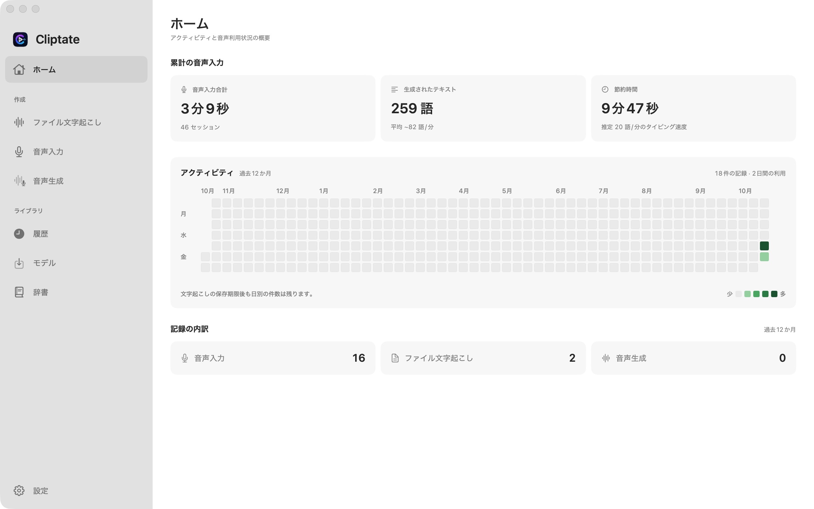

<div align="center">
  
  <h1>Cliptate</h1>
  <p><strong>Mac 向け映像・音声クリエイターのためのオンデバイス AI ワークスペース</strong></p>

  <p>
    <a href="https://github.com/cliptate/cliptate/releases"></a>
    
    
    
    
  </p>

  <p>
    <a href="https://cliptate.github.io">ウェブサイト</a> ·
    <a href="https://github.com/cliptate/skills">Skills</a> ·
    <a href="https://cliptate.github.io#features">機能</a> ·
    <a href="https://cliptate.github.io#voice">音声・TTS</a> ·
    <a href="https://github.com/cliptate/cliptate/releases">ダウンロード</a>
  </p>

  <p>
    <a href="../README.md">English</a> ·
    <a href="README.zh.md">中文</a> ·
    <a href="README.ja.md">日本語</a> ·
    <a href="README.ko.md">한국어</a> ·
    <a href="README.de.md">Deutsch</a>
  </p>
</div>

---

Cliptate は、音声を編集可能なテキスト、字幕、ラフカットに変換するネイティブ macOS アプリです。Apple Silicon Mac 上のモデルで、録音の文字起こし、他のアプリへの音声入力、無音部分のカット、音声合成を行えます。

**GitHub ダウンロード版は無料です。** すべてのモデルと Pro 機能が利用でき、サブスクリプションや購入は不要です。任意のオンライン AI 機能には、ご自身で設定したサービスを使用します。



中央の読み込み領域に動画をドロップするか、クリックしてファイルを選択します。複数の動画をまとめて読み込めます。左側のサイドバーで機能を切り替え、下部からいつでも**設定**を開けます。

表示言語は英語、簡体字中国語、日本語、韓国語、ドイツ語に対応し、**設定 → 言語**で切り替えられます。

[使い始める](#使い始める) · [機能](#機能) · [コマンドライン](#コマンドライン) · [プライバシーとモデル](#プライバシーとモデル) · [ソースからビルド](#ソースからビルド)

## 使い始める

### ダウンロードとインストール

1. [GitHub Releases](https://github.com/cliptate/cliptate/releases/latest) から `Cliptate.dmg` をダウンロードします。毎日のビルドは [Nightly プレリリース](https://github.com/cliptate/cliptate/releases/tag/nightly)で入手できます。
2. DMG を開き、**Cliptate.app** を**アプリケーション**フォルダにドラッグして起動します。
3. **モデル（Models）** を開き、文字起こしや音声合成を始める前に必要なモデルをダウンロードします。

リリースパッケージは Developer ID で署名され、Apple の公証を受けています。SHA-256 チェックサムファイルも提供されます。[インストールと検証のガイド](development.md#dmg-packages-and-ci-downloads)をご覧ください。直接ダウンロード版は[アプリ内更新](updates.md)に対応しています。

### 動作要件

| 要件 | 詳細 |
| --- | --- |
| Mac | Apple Silicon（M1 以降） |
| OS | macOS 15 Sequoia 以降 |
| ストレージとメモリ | 選択したモデルによって異なります。サイズはモデル画面で確認できます |
| ネットワーク | 初回のモデルダウンロードと任意のオンラインサービスに必要です |

### 最初のワークフロー

- **録音・動画：** **AI Cut** を開き、ファイルを読み込み、文字起こしモデルと言語を選択します。テキストと無音部分のカットを確認してから書き出します。
- **リアルタイム音声入力：** **Voice To Text** でモデルとショートカットを設定し、マイクへのアクセスを許可します。直接ダウンロード版では、アクセシビリティ権限で他のアプリにテキストを入力します。クリップボードからの貼り付けも利用できます。
- **音声合成：** TTS モデルを選択してテキストを入力し、そのモデルが対応するプリセット音声、参照音声、または声の説明を指定します。

## 機能

| ワークフロー | できること |
| --- | --- |
| **オフライン文字起こし** | Parakeet、Qwen3 ASR、FireRed、Cohere モデルで音声・動画を一括処理。言語とハードウェアに合ったエンジンを選べます。 |
| **音声入力** | ストリーミング文字起こし、カスタム辞書、設定可能な音声入力ショートカット。 |
| **AI Cut** | 音声区間検出（VAD）で無音部分を検出し、区間を確認してラフカットを書き出します。 |
| **話者ラベル** | 対応する文字起こし処理では Sortformer で話者を区別します。Silero VAD は音声を検出しますが、話者は識別しません。 |
| **音声合成** | Qwen3 TTS によるプリセット音声、声のクローン、感情・スタイル指定、ボイスデザイン。使える設定はモデルによって異なります。 |
| **修正と翻訳** | 任意のオンライン AI サービスでテキスト修正とキーワード強調。Apple 翻訳で対応する言語ペアの字幕を翻訳します。 |
| **コマンドライン** | スクリプトや AI エージェントから文字起こし、WAV 音声生成、カスタム辞書管理を行えます。 |

## 書き出し

| 出力 | 形式と用途 |
| --- | --- |
| 編集タイムライン | Final Cut Pro 用の **FCPXML** |
| 字幕・文字起こし | アプリから **SRT**、スタイル付き **ASS**、タイムスタンプ付き **TXT** |
| 動画 | **MP4**、**MOV**、**M4V**。字幕の焼き込みも可能 |
| 音声 | **M4A**、**WAV** |
| CLI 文字起こし | **Text**、**JSON**、**Markdown**、**SRT**、**VTT** |

字幕とレンダリング済みメディアは、各編集ソフトが対応する形式に応じて DaVinci Resolve や Adobe Premiere Pro などで利用できます。FCPXML は Final Cut Pro のタイムライン向けです。

## コマンドライン

直接ダウンロード版には CLI が付属します。アプリをアプリケーションフォルダに移動し、**設定 → コマンドライン（Settings → Command Line）** でインストールコマンドをコピーしてターミナルで実行します。[CLI ガイド](cli.md)に従って `~/.local/bin` をシェルの `PATH` に追加してください。

```bash
cliptate transcribe interview.mp4 --format srt --output interview.srt
cliptate transcribe recording.wav --format json --download
cliptate tts --text "Cliptate へようこそ。" --output speech.wav --download
cliptate dictionary add "Cliptate" "MLX"
```

CLI はアプリで選択したモデルと設定を使用し、必要に応じてアプリをバックグラウンドで起動します。`--download` は不足するモデルのダウンロードを許可します。CLI の文字起こしはローカルファイルを受け付け、プロジェクトや履歴を作成しません。バッチ出力、モデルの指定、スクリプトでの利用については `cliptate --help` または[完全なコマンドリファレンス](cli.md)をご覧ください。

## プライバシーとモデル

- **ローカル音声処理：** 文字起こし、VAD、話者識別、TTS 推論は Mac 上で実行します。ダウンロード済みの音声モデルはオフラインで利用できます。
- **任意のオンライン AI：** 修正とキーワード抽出は、設定したサービスにテキストを送信します。オフラインで音声を処理する場合は無効にしてください。
- **翻訳：** Apple 翻訳では言語リソースのダウンロードが必要な場合があります。利用可否は言語ペアによって異なります。
- **モデル保存：** 重みは別途ダウンロードします。直接ダウンロード版は `~/.cache/huggingface/hub` のキャッシュを再利用できます。[キャッシュの詳細](development.md#shared-model-cache)をご覧ください。
- **ライセンス：** アプリは [MIT ライセンス](../LICENSE)です。モデルの重みと依存ライブラリにはそれぞれのライセンスが適用されます。[第三者ライセンス](../THIRD_PARTY_NOTICES.md)をご覧ください。

## ソースからビルド

Apple Silicon、macOS 15+、**Xcode 26+（Swift 6.2+）** が必要です。Xcode テストターゲットには macOS 15.5+ が必要です。

```bash
git clone https://github.com/cliptate/cliptate.git
cd cliptate
export DEVELOPER_DIR=/Applications/Xcode.app/Contents/Developer
export CLIPTATE_APP_STORE=NO
swift build
swift test
./scripts/run.sh
```

SwiftPM はライブラリと CLI をビルドし、ユニットテストを実行します。`./scripts/run.sh` は Xcode アプリ **Cliptate Dev.app** をビルドして起動します。開発用の設定とデータは独立しています。起動せずにビルドするには `./scripts/build-and-run.sh build` を使用します。

`CLIPTATE_APP_STORE=NO` は、CLI とアクセシビリティを使う音声入力を含む無料の直接配布チャネルを選択します。デフォルトのソースビルドは App Store の機能制限とサブスクリプション動作を維持します。課金には独自のローカル設定が必要です。署名、モデルキャッシュ、配布設定は[開発ガイド](development.md)をご覧ください。

## 貢献とサポート

不具合や機能の提案は [GitHub Issues](https://github.com/cliptate/cliptate/issues) へ。macOS のバージョン、アプリのバージョン、選択したモデル、再現手順を記載し、個人の録音や認証情報は公開しないでください。

- [貢献ガイド](../CONTRIBUTING.md) — 開発フロー、検証、コミット規約
- [アーキテクチャ](architecture/README.md) — コード構成とランタイムの境界
- [リリースノート](release-notes/README.md#version-archive) — バージョン履歴
- [セキュリティポリシー](../SECURITY.md) — 脆弱性の報告
- [公式サイト](https://cliptate.github.io) — 製品紹介
