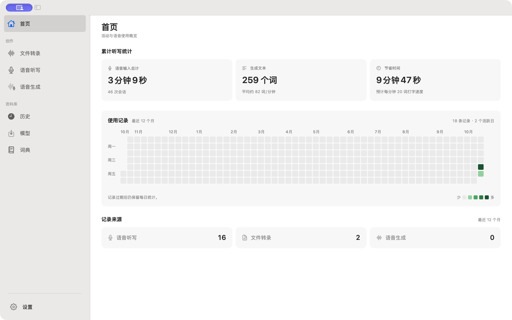

<div align="center">
  
  <h1>Cliptate</h1>
  <p><strong>面向 Mac 音视频创作者的端侧 AI 工作台</strong></p>

  <p>
    <a href="https://github.com/cliptate/cliptate/releases"></a>
    
    
    
    
  </p>

  <p>
    <a href="https://cliptate.github.io">官网</a> ·
    <a href="https://cliptate.github.io#features">功能介绍</a> ·
    <a href="https://cliptate.github.io#voice">语音与 TTS</a> ·
    <a href="https://github.com/cliptate/cliptate/releases">立即下载</a>
  </p>

  <p>
    <a href="../README.md">English</a> ·
    <a href="README.zh.md">中文</a> ·
    <a href="README.ja.md">日本語</a> ·
    <a href="README.ko.md">한국어</a> ·
    <a href="README.de.md">Deutsch</a>
  </p>
</div>

---

Cliptate 是一款原生 macOS 应用，将转写、听写、剪辑和语音合成整合到同一工作流。语音模型在 Mac 本地运行，也可以单独配置在线 AI 纠错和翻译服务。



---

## 从源码构建

也可从 [GitHub Releases](https://github.com/cliptate/cliptate/releases)
下载正式版本或每日 Nightly 构建的 DMG 和 SHA-256 校验文件，无需登录 GitHub。
发布构建使用 Developer ID 签名并经 Apple 公证，安装说明见[开发指南](development.md#dmg-packages-and-ci-downloads)。

完整应用以 [MIT 许可证](../LICENSE)开源。需要 Apple Silicon、macOS 15+、
Xcode 26+（Swift 6.2+）。

```bash
git clone https://github.com/cliptate/cliptate.git
cd cliptate
export DEVELOPER_DIR=/Applications/Xcode.app/Contents/Developer
swift test
./scripts/run.sh
```

应用源码位于 `Sources/Cliptate`，测试位于 `Tests`，Xcode 工程位于仓库根目录，
工具脚本位于 `scripts`。参见[开发指南](development.md)、
[架构说明](architecture/README.md)、[贡献指南](../CONTRIBUTING.md)和
[第三方许可](../THIRD_PARTY_NOTICES.md)。
源码构建可选择配置自己的订阅服务；模型权重单独下载，遵循各自许可证。


## 功能

### 🎙 语音听写 — 说话即输入

实时流式语音转文字，像输入法一样随时唤起。通过全局快捷键从任意应用调出，说话即可生成可编辑文本。

- 流式实时转写，低延迟输出
- 多说话人自动识别与标注
- 自定义词典，提升专有词汇准确率
- 全局快捷键随时唤起或暂停

### 📝 离线转写

批量转写音视频文件，全程在设备端完成。支持多种 ASR 引擎（Parakeet、Qwen3、FireRed ASR）和针对 Apple Silicon 优化的 MLX 推理，生成精准字幕，不向任何服务器发送音频。

### ✂️ 智能去停顿

基于 VAD 的静音检测，自动识别并批量裁剪播客、访谈、课程录音中的冗余停顿，让粗剪更快接近可交付状态。

### 👥 说话人识别

自动识别录音中的多位说话人并分段标注。Sortformer 与 Silero VAD 模型在设备端运行，为访谈、圆桌和会议记录生成结构清晰、带说话人归属的逐字稿。

### 🔊 TTS 语音合成 — 四种模式

| 模式 | 说明 |
|---|---|
| **预设音色** | 内置多语言音色库，即开即用 |
| **声音克隆** | 上传参考音频，复现说话人的音色与节奏 |
| **情感控制** | 通过提示词调控指定音色的情感与表达风格 |
| **音色设计** | 用文字描述生成完全原创的声音形象 |

所有 TTS 推理均通过 MLX 在设备端完成，音频不上传云端。

### 🌐 AI 纠错与翻译

上下文感知的字幕纠错，结合设备端或 Apple 翻译生成多语言输出，无需切换工具即可制作面向全球受众的内容。

### ⭐ 高亮标记

自动识别录音中最关键的句子与精彩片段，并在时间线上标注——让剪辑和发布流程更快推进。

---

## 导出格式

Cliptate 直接输出你常用工具所需的格式：

| 格式 | 用途 |
|---|---|
| **FCPXML** | Final Cut Pro 时间线工程交换 |
| **SRT** | 通用字幕交付 |
| **ASS** | 带样式与定位的字幕格式 |
| **VTT** | 适用于浏览器与流媒体平台的网页字幕 |

兼容 **Final Cut Pro**、**DaVinci Resolve** 和 **Adobe Premiere Pro**。

---

## 隐私与安全

- **本地语音推理** — ASR、VAD、说话人识别和 TTS 在 Mac 上运行
- **可选在线服务** — 在线 AI 纠错和翻译使用你配置的端点和 API 密钥
- **本地模型可离线使用** — 模型下载、订阅和可选在线服务需要网络
- 处理敏感内容时请选择本地服务

---

## 系统要求

| | |
|---|---|
| **平台** | macOS 15 Sequoia 或更高版本 |
| **架构** | Apple Silicon（M1 及以上） |
| **存储空间** | 因模型选择而异（完整模型组约 2–8 GB） |

---

## 技术栈

采用 SwiftUI / AppKit 原生界面、AVFoundation 媒体处理、MLX Audio 本地推理、Hugging Face 模型下载，以及 RevenueCat / StoreKit 可选订阅服务。

---

## 适用场景

**播客主与访谈者** — 去停顿、生成字幕、标记可发布片段，无需离开应用。

**Vlog 与短视频创作者** — 让口播剪辑更顺滑，专注于节奏和表达。

**课程制作者与会议记录者** — 通过实时听写或批量转写，将数小时录音转化为可检索、可翻译的文本资产。

**多语言内容团队** — 克隆声音、翻译字幕、生成配音版本——全在一台 Mac 上完成。

---

## 链接

- **官网：** [cliptate.github.io](https://cliptate.github.io)
- **下载：** [下载 Cliptate](https://github.com/cliptate/cliptate/releases)
- **问题与反馈：** [GitHub Issues](https://github.com/cliptate/cliptate/issues)

---

<div align="center">
  <sub>为重视隐私、速度与专业输出的创作者而生。</sub>
</div>
